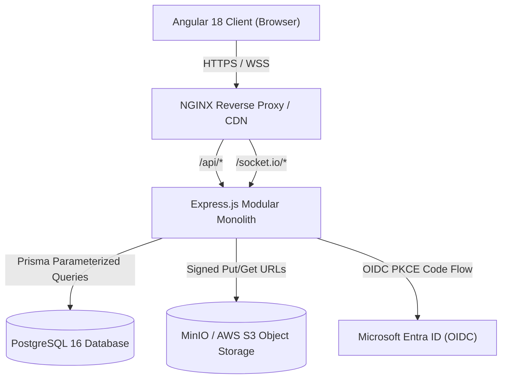
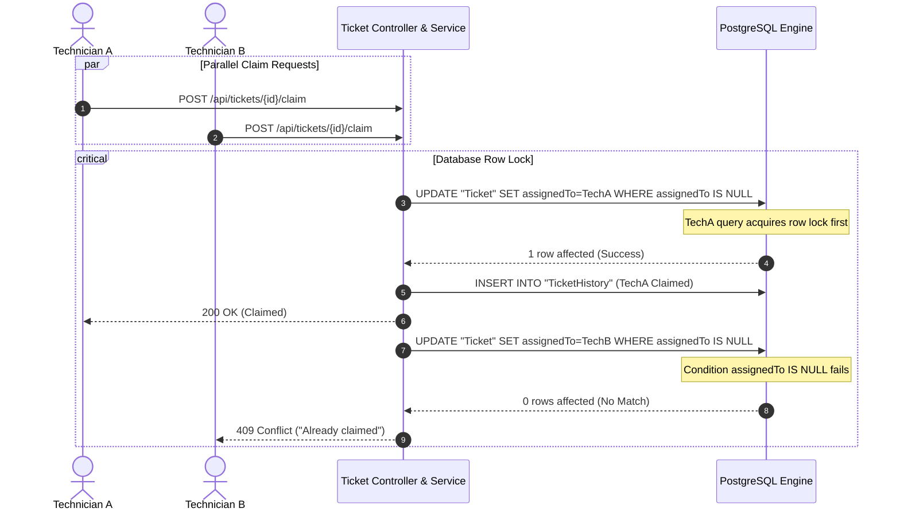
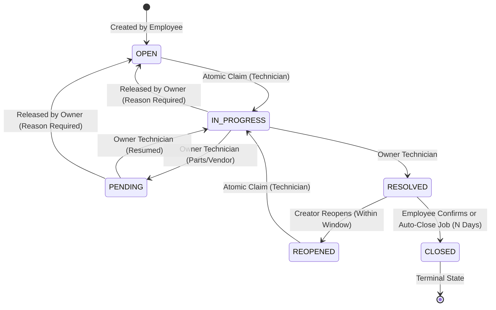

# Architecture & Technical Design

This document details the architectural blueprints, data flow, concurrency controls, and security posture of the **Global Exchange IT Help Desk and Ticketing System**.

---

## 1. High-Level Architecture Overview

The system is constructed as a **modular monolith** adhering to strict separation of concerns:
- **Presentation Layer (Frontend)**: Angular 18 (Standalone components, TypeScript strict, Tailwind CSS, Reactive Forms, RxJS).
- **Controller Layer (HTTP API)**: Express route handlers managing HTTP status codes, parsing, and DTO extraction.
- **Service Layer (Domain Logic)**: Pure business rules, state machine transitions, concurrency guards, and audit logging.
- **Repository / Persistence Layer**: Prisma ORM with parameterized PostgreSQL queries and native transactional locking.
- **Real-Time Communication**: Authenticated Socket.IO with cookie-based handshake, per-user rooms, and role-segregated rooms.
- **Object Storage**: S3-compatible private object storage (MinIO in local Docker, AWS S3 in production) serving files via short-lived signed URLs.



---

## 2. Security & Compliance Architecture

### 2.1 Defense in Depth
1. **No Client Trust**: Every business rule, role authorization, state transition, and file validation is enforced solely on the backend.
2. **Session Security**: Server-side sessions in PostgreSQL with:
   - 32-byte cryptographically secure random session tokens.
   - `httpOnly`, `Secure` (in HTTPS/production), and `SameSite=Lax` cookies.
   - Idle timeout (30 minutes) and absolute session timeout (8 hours).
   - Session revocation on logout and user deactivation.
3. **Double-Submit CSRF**:
   - Random CSRF token generated in `XSRF-TOKEN` cookie.
   - Required in `X-CSRF-Token` header for state-changing HTTP methods (`POST`, `PUT`, `PATCH`, `DELETE`).
4. **Sensitive Data Guard**:
   - Automatic scan of ticket titles, descriptions, and comments.
   - Luhn algorithm validation rejects payment card numbers (13–19 digits).
   - Credential regex blocks plaintext passwords and API keys.
5. **Secure Upload Verification**:
   - MIME allowlist: `image/png`, `image/jpeg`, `application/pdf`, `text/plain`, `docx`.
   - Magic byte inspection using `file-type` buffer inspection (disallowing file extension spoofing).
   - Max 10MB per file, max 5 files per ticket.
   - Storage keys are randomized UUIDs (e.g. `tickets/{id}/{uuid}.{ext}`).
   - `IVirusScanner` hook with mock / ClamAV integration rejecting infected uploads.

---

## 3. Atomic Claiming & Concurrency Engine

### 3.1 The Race Condition Challenge
In financial institutions, when high-priority or critical incidents occur, multiple IT technicians often attempt to claim the incident at the exact same millisecond. Traditional `SELECT ... UPDATE` flows result in race conditions, double assignment, and conflicting audit trails.

### 3.2 Single Statement Conditional Atomic Update
The claiming engine guarantees atomicity via PostgreSQL's atomic row-level locking executed as a single conditional update statement:

```sql
UPDATE "Ticket"
SET "assignedToId" = $1,
    "status" = 'IN_PROGRESS'::"TicketStatus",
    "claimedAt" = NOW(),
    "version" = "version" + 1,
    "updatedAt" = NOW()
WHERE "id" = $2
  AND "assignedToId" IS NULL
  AND "status" IN ('OPEN'::"TicketStatus", 'REOPENED'::"TicketStatus");
```

### 3.3 Execution Protocol:
1. Within a database transaction, the update query runs with affected row count feedback.
2. If `affected_rows === 0`:
   - The ticket was already claimed or moved to another status by a competing technician.
   - The transaction immediately rolls back and returns **HTTP 409 Conflict**: `"Ticket already claimed by another technician"`.
3. If `affected_rows === 1`:
   - The technician successfully acquired the claim.
   - The same transaction inserts a `TicketHistory` row recording the claim actor and timestamp.
   - Transaction commits.
   - Asynchronous Socket.IO broadcast notifies all other technicians to remove the ticket from their Available list.



---

## 4. State Machine & Lifecycle Transitions

Allowed Statuses: `OPEN`, `IN_PROGRESS`, `PENDING`, `RESOLVED`, `CLOSED`, `REOPENED`.



### Transition Enforcement Rules:
- Any transition not explicitly permitted in the matrix returns **HTTP 409 Conflict**.
- Every valid transition writes a `TicketHistory` record in the **same database transaction** as the status update.
- `CLOSED` is strictly terminal.

---

## 5. Employee Isolation & Internal Notes Confidentiality

- **Ticket Isolation**: Employees can only query tickets where `requesterId === req.user.id`. Requests to other tickets return **HTTP 404 Not Found** (preventing ID enumeration).
- **Internal Notes Security**:
  - Comments have `visibility: PUBLIC | INTERNAL`.
  - Technicians and Admins can create internal technical notes.
  - Employees attempting to post internal notes receive **HTTP 403 Forbidden**.
  - All employee comment queries explicitly filter `where: { visibility: 'PUBLIC' }`.
  - Realtime Socket.IO emitters check visibility: internal notes are broadcast **strictly to staff rooms** (`role:TECHNICIAN` and `role:ADMIN`) and never to employee user rooms.
